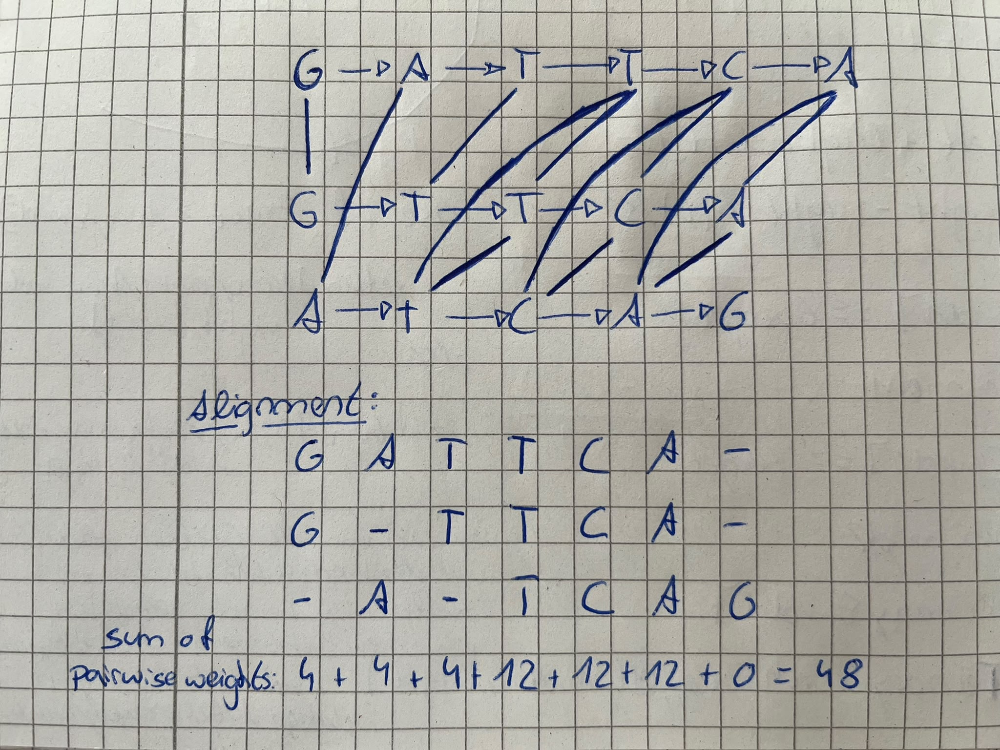

**1 Three sequences by integer linear programming**

```java
java ILP4MSA_Becker_Ropertz.java  book.fasta 4 1 | Out-File -Encoding ascii problem.lp
ILP for TCAG, TCCTA, CTAG (match 4, mismatch 1)
Variables:                       56
Constraints, two sequences:      344
Constraints, three sequences:    2840
Variables declared binary:       56
```

lp_solve output:
Value of objective function: 36.00000000

Actual values of the variables:
x1_1_2_1                        1
x1_1_2_2                        0
x1_1_2_3                        0
x1_1_2_4                        0
x1_1_2_5                        0
x1_2_2_1                        0
x1_2_2_2                        0
x1_2_2_3                        1
x1_2_2_4                        0
x1_2_2_5                        0
x1_3_2_1                        0
x1_3_2_2                        0
x1_3_2_3                        0
x1_3_2_4                        0
x1_3_2_5                        1
x1_4_2_1                        0
x1_4_2_2                        0
x1_4_2_3                        0
x1_4_2_4                        0
x1_4_2_5                        0
x1_1_3_1                        0
x1_1_3_2                        0
x1_1_3_3                        0
x1_1_3_4                        0
x1_2_3_1                        1
x1_2_3_2                        0
x1_2_3_3                        0
x1_2_3_4                        0
x1_3_3_1                        0
x1_3_3_2                        0
x1_3_3_3                        1
x1_3_3_4                        0
x1_4_3_1                        0
x1_4_3_2                        0
x1_4_3_3                        0
x1_4_3_4                        1
x2_1_3_1                        0
x2_1_3_2                        0
x2_1_3_3                        0
x2_1_3_4                        0
x2_2_3_1                        0
x2_2_3_2                        0
x2_2_3_3                        0
x2_2_3_4                        0
x2_3_3_1                        1
x2_3_3_2                        0
x2_3_3_3                        0
x2_3_3_4                        0
x2_4_3_1                        0
x2_4_3_2                        1
x2_4_3_3                        0
x2_4_3_4                        0
x2_5_3_1                        0
x2_5_3_2                        0
x2_5_3_3                        1
x2_5_3_4                        0

```java
java ILP4MSA_Becker_Ropertz.java  long.fasta 4 1 | Out-File -Encoding ascii long.lp    
ILP for GATTCA, GTTCA, ATCAG (match 4, mismatch 1)
Variables:                       85
Constraints, two sequences:      770
Constraints, three sequences:    9150
Variables declared binary:       85
```

e) 
Sequences in long.fasta:

S1: GATTCA  
S2: GTTCA  
S3: ATCAG

(optimal) trace output after the following command used in Windows powershell:
```powershell
lp_solve -S3 long.lp | Select-String "^x\S+\s+1$"
```

| variable |     | position    | letter |
| -------- | --- | ----------- | ------ |
| x1_1_2_1 | 1   | S1[1]-S2[1] | G      |
| x1_3_2_2 | 1   | S1[3]-S2[2] | T      |
| x1_4_2_3 | 1   | S1[4]-S2[3] | T      |
| x1_5_2_4 | 1   | S1[5]-S2[4] | C      |
| x1_6_2_5 | 1   | S1[6]-S2[5] | A      |
| x1_2_3_1 | 1   | S1[2]-S3[1] | A      |
| x1_4_3_2 | 1   | S1[4]-S3[2] | T      |
| x1_5_3_3 | 1   | S1[5]-S3[3] | C      |
| x1_6_3_4 | 1   | S1[6]-S3[4] | A      |
| x2_3_3_2 | 1   | S2[3]-S3[2] | T      |
| x2_4_3_3 | 1   | S2[4]-S3[3] | C      |
| x2_5_3_4 | 1   | S2[5]-S3[4] | A      |
12 edges, all matches: $12\cdot 4 = 48$

extended alignment graph:


-> the trace is not optimal. The first T in sequence 3 can be matched to a different T in sequence 1 and sequence 2

A second trace with weight 48 can be achieved from the trace above:
- Remove: x1_4_3_2, x2_3_3_2
- Add: x1_3_3_2 (T-T), x2_2_3_2 (T-T)
- the other 10 edges stay unchanged

$$
\begin{array}{l|ccccccc|l} & G & A & T & T & C & A & - \\ 
& G & - & T & T & C & A & - \\ 
& - & A  & T & - & C  &A & G\\ \hline
 \text{score}&4 & 4&12 & 4 & 12 & 12 & 0 & 48   \end{array}
$$

**2 The ILP for two sequences, by hand**


