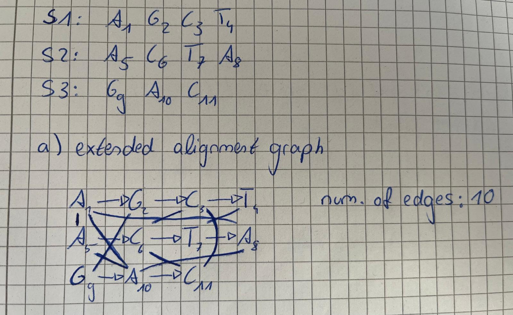

**1 Three sequences by integer linear programming**

```java
java ILP4MSA_Becker_Ropertz.java  book.fasta 4 1 | Out-File -Encoding ascii problem.lp
ILP for TCAG, TCCTA, CTAG (match 4, mismatch 1)
Variables:                       56
Constraints, two sequences:      344
Constraints, three sequences:    2840
Variables declared binary:       56
```

```java
java ILP4MSA_Becker_Ropertz.java  long.fasta 4 1 | Out-File -Encoding ascii long.lp    
ILP for GATTCA, GTTCA, ATCAG (match 4, mismatch 1)
Variables:                       85
Constraints, two sequences:      770
Constraints, three sequences:    9150
Variables declared binary:       85
```

e) 
Sequences in long.fasta:

S1: GATTCA  
S2: GTTCA  
S3: ATCAG

(optimal) trace output after the following command used in Windows PowerShell:
```powershell
lp_solve -S3 long.lp | Select-String "^x\S+\s+1$"
```

| variable |     | position    | letter |
| -------- | --- | ----------- | ------ |
| x1_1_2_1 | 1   | S1[1]-S2[1] | G      |
| x1_3_2_2 | 1   | S1[3]-S2[2] | T      |
| x1_4_2_3 | 1   | S1[4]-S2[3] | T      |
| x1_5_2_4 | 1   | S1[5]-S2[4] | C      |
| x1_6_2_5 | 1   | S1[6]-S2[5] | A      |
| x1_2_3_1 | 1   | S1[2]-S3[1] | A      |
| x1_4_3_2 | 1   | S1[4]-S3[2] | T      |
| x1_5_3_3 | 1   | S1[5]-S3[3] | C      |
| x1_6_3_4 | 1   | S1[6]-S3[4] | A      |
| x2_3_3_2 | 1   | S2[3]-S3[2] | T      |
| x2_4_3_3 | 1   | S2[4]-S3[3] | C      |
| x2_5_3_4 | 1   | S2[5]-S3[4] | A      |
12 edges, all matches: $12\cdot 4 = 48$

extended alignment graph:


-> the trace is not optimal. The first T in sequence 3 can be matched to a different T in sequence 1 and sequence 2

A second trace with weight 48 can be achieved from the trace above:

- Remove: x1_4_3_2, x2_3_3_2
- Add: x1_3_3_2 (T-T), x2_2_3_2 (T-T)
- the other 10 edges stay unchanged

$$
\begin{array}{l|ccccccc|l} & G & A & T & T & C & A & - \\ 
& G & - & T & T & C & A & - \\ 
& - & A  & T & - & C  &A & G\\ \hline
 \text{score}&4 & 4&12 & 4 & 12 & 12 & 0 & 48   \end{array}
$$

**2 The ILP for two sequences, by hand**

X = TCA, Y = TTA
match +2
mismatch -1

objective (nine terms):

|           | $Y_1$ = T | $Y_2$ = T | $Y_3$ = A |
| --------- | --------- | --------- | --------- |
| $X_1$ = T | +2        | +2        | -1        |
| $X_2$ = C | -1        | -1        | -1        |
| $X_3$ = A | -1        | -1        | +2        |

max: 2 x11 + 2 x12 - x13 - x21 - x22 - x23 - x31 - x32 + 2 x33

x11, x12 are T-T, x33 is A-A, and the other six are mismatches.

Each position at most once (sum form):
x11 + x12 + x13 ≤ 1     (X1)        x11 + x21 + x31 ≤ 1     (Y1)
x21 + x22 + x23 ≤ 1     (X2)        x12 + x22 + x32 ≤ 1     (Y2)
x31 + x32 + x33 ≤ 1     (X3)        x13 + x23 + x33 ≤ 1     (Y3)

Crossing constraints: $x_{ij} + x_{i'j'} \leq 1$ for $i < i'$ and $j > j'$

x12 + x21 ≤ 1    x13 + x21 ≤ 1    x13 + x22 ≤ 1
x12 + x31 ≤ 1    x13 + x31 ≤ 1    x13 + x32 ≤ 1
x22 + x31 ≤ 1    x23 + x31 ≤ 1    x23 + x32 ≤ 1

|                            | sum form  | pairwise form |
| -------------------------- | --------- | ------------- |
| Each position at most once | 3 + 3 = 6 | 9 + 9 = 18    |
| Crossing                   | 9         | 9             |

-> 27 constraints in total

Solution by inspection:

mismatches have negative weight, so the optimum uses only matches. The matches are x11, x12, and x33, and x11 and x12 cannot both be used because they share X1. The best choices are:

- {x11, x33} with weight 4
- {x12, x33} with weight 4

The optimal weight is 4, and the optimal trace is not unique. For {x11, x33} the alignment is:

$$
\begin{array}{ccccc|l}
X: & T & C & - & A \\
Y: & T & - & T & A\\ \hline
\text{score} & 2 & 0 & 0 & 2 & 4
\end{array}
$$

**3 Simple mixed cycles**



b) + c) 4 mixed cycles and their constraints

| #   | Cycle                        | Sequences  | Constraints                          |
| --- | ---------------------------- | ---------- | ------------------------------------ |
| 1   | A1 → C3 − C6 → A8 − A1       | S1, S2     | x(A1,A8) + x(C3,C6) ≤ 1              |
| 2   | A5 → A8 − A10 − A5           | S2, S3     | x(A8,A10) + x(A5,A10) ≤ 1            |
| 3   | G2 − G9 → A10 − A5 − A1 → G2 | S1, S2, S3 | x(G2,G9) + x(A5,A10) + x(A1,A5) ≤ 2  |
| 4   | A1 → T4 − T7 → A8 − A10 − A1 | S1, S2, S3 | x(T4,T7) + x(A8,A10) + x(A1,A10) ≤ 2 |


