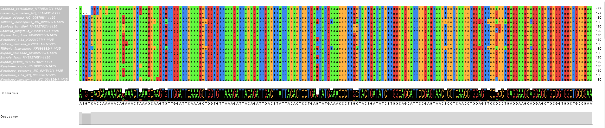
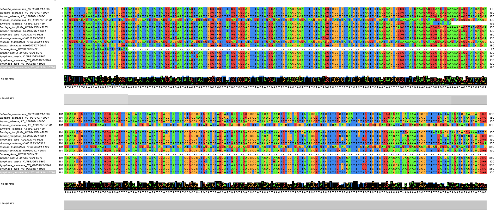
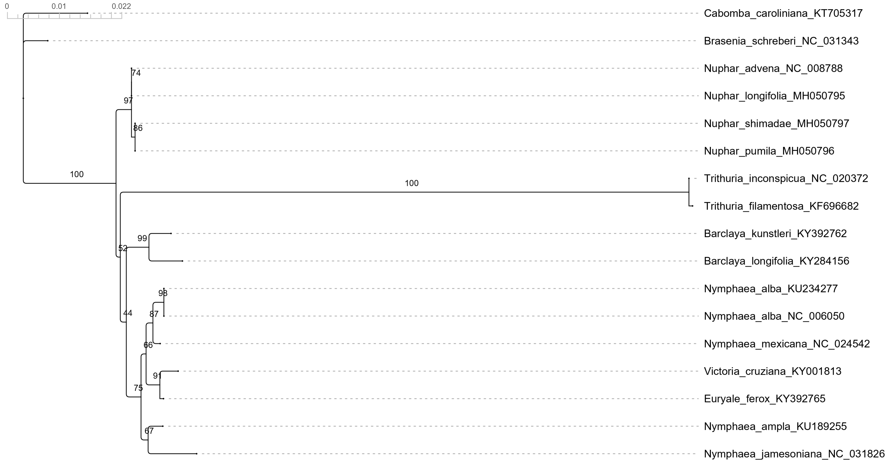
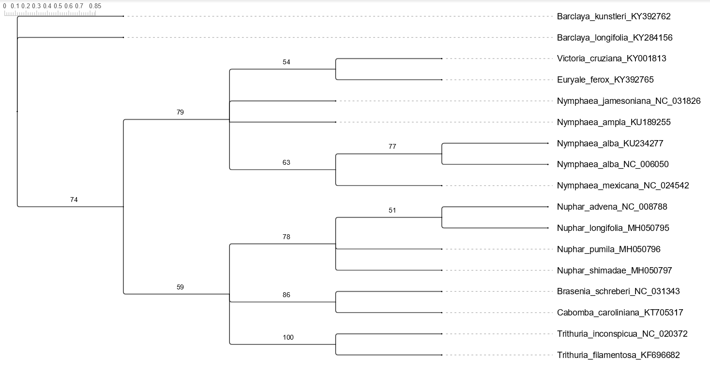
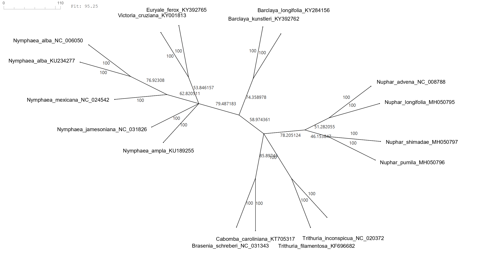
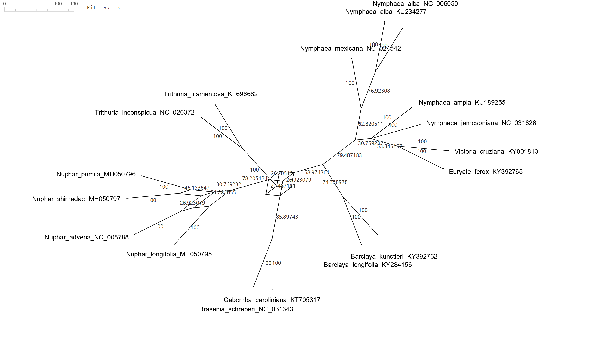

### Assignment 4

WS26/27
Remi Becker, Nina Ropertz

#### 1: Biological Background
- What are the data?
  78 protein-coding plastome genes
- Which plant families and genera do the 17 genomes represent?
  3 families with a total of 8 genera:
    - Nymphaeaceae (5 genera)
    - Cambombaceae (2 genera)
    - Hydatellaceae (1 genus)
- Which of them is the outgroup?
  Hydatellaceae
- What is the main question?
  Evaluating evolutionary relationships within Nymphaeales, especially to re-assess the monophyly of Nymphaeaceae by assessing whether the results of phylogenetic inference performed individual genes are congruent across genes and those performed on the multiple alignment congruent under different data partitioning schemes.
- Why does the genus *Nuphar* matter for it?
  The phylogenetic position of the genus *Nuphar* is so far unresolved and would affect the taxanomic status of Nymphaeaceae as a monophyletic group. Determining this would help in the effort to understand the evolutionary history of early-diverging angiosperms.

#### 2: Multiple sequence alignment
a) 
We used MAFFT 7.526 with the following parameters <mark style="background: #FFB8EBA6;">--auto --thread 4</mark>. The programm was initiated with one call per gene in a loop over all 78 FASTA-files. The strategy is chosen depending on the size of the data. According to the log-files, L-INS-i was used for 74 genes while FFT-NS-i was used for the four genes (rpoB, rpoC2, ycf1, ycf2). These four genes have the longest alignment lengths (3234, 4311, 6860, 7721), which suggests MAFFT switched to a faster strategy for the longest alignments. The gap costs are the standard values (opening 1.53, extending 0).

MAFFT is a heuristic progressive method with iterative refinement. Based on pairwise alignments a UPGMA-guide-tree is computed for L-INS-i. For FFT-NS-i, MAFFT derives the distances from shared k-mer counts instead of full pairwise alignments. The sequences are initially aligned along the tree, and subsequently the alignment is iteratively refined by means of splitting into subgroups and realigned as long as the score improves.

- L-INS-i additionally uses local pairwise alignments as additional information and is consistency based with that. It is the most accurate but slowest version.

- FFT-NS-i starts with a fast progressive alignment. The pairwise alignment is sped up by a Fast-Fourier-Transformation and later refined iteratively. It does not use lokal pair information but is much faster and more suitable for long sequences.

Both are heuristics, because the exact multiple alignment is NP-hard. MAFFT is an independent tool, but its core is the progressive alignment of Section 2.4, with the same weakness in early errors bound into it. This problem is addressed by the iterative refinement and the consistency information in L-INS-i. In the book, MAFFT is listed under other tools

Commands used in Windows PowerShell:
```powershell
# creating folder aln for the alignment
mkdir aln

# saving the path to maaft.bat in the variable $mafft
$mafft = "C:\path\to\mafft-7.526-win64-signed\mafft-win\mafft.bat"

# alignment (run in the folder with the FASTA-files)
Get-ChildItem *.fasta | Where-Object { $_.Name -notlike "*.aln.fasta" } | ForEach-Object {      
>>      $g = $_.BaseName
>>      cmd /c "`"$mafft`" --auto --thread 4 $($_.Name) > aln\$g.aln.fasta 2> aln\$g.mafft.log"
>>    }

# which strategy did MAFFT choose?
Select-String -Path aln\*.mafft.log -Pattern "L-INS-i|FFT-NS|E-INS-i|G-INS-i" | Group-Object Line | Select Count, Name

# which genes got FFT-NS-i?
Select-String -Path aln\*.mafft.log -Pattern "FFT-NS-i" | ForEach-Object { $_.Filename -replace '\.mafft\.log$','' }

# which alignments are the longest? (run in the folder that contains the table.tsv file)
Import-Csv table.tsv -Delimiter "`t" | Sort-Object { [int]$_.aln_length } -Descending | Select-Object -First 8
```
 
 
b)
The table.tsv file contains a table with the number of sequences, the length of the alignment and the number of columns that contain a gap, for every gene. 

Number of genes: 78
shortest alignment: petL (93)
longest alignment:  ycf2 (7721)
Gene without gap: 27

c)
rbcL gap-lengths (gap-lengths=number of sequences): {3=2}

matK gap-lengths (gap-lengths=number of sequences): {3=13, 6=28, 9=2, 12=2}

All gap-lengths are a multiple of three. rbcL only has gaps of length 3, matK has gaps of length 3, 6, 9 and 12. This is as expected for protein coding genes. An insertion or deletion, that is not a multiple of three, would shift the reading frame and destroy the rest of the protein. For multiples of three, whole codons are removed or added.

ycf1 has a gap in almost every column because there are two sequence that are nearly empty. Euryale_ferox_KY392765 has a length of 27 and adds 6833 gaps to the alignment. Barclaya_kunstleri_KY392762 has a length of 165 and adds 6695 gaps to the alignment. Every other sequence in the alignment has a length between 5199 and 6024 bases. To align these two short sequences to the rest requires adding gaps to almost every column.

#### 3: visualization of multiple sequence alignments 

Jalview was used to open the alignments of rbcL and ycf1. The names of the aligned sequences are shown next to the alignment. Depending on the chosen settings, different aspects of the alignment can be shown. The bases can be colored depending on percentage identity or nucleotide. A consensus can be shown as consensus sequence and as sequence with colored bases whose height shows how dominant a base is in the column. A tall single letter means conserved, a stack of small letters means variable. By hovering over the consensus sequence the percentage of each base in that column can be viewed. There is also an occupancy bar, that visualizes the number of sequences that have a base in each column. A full bar means no gaps, a lower bar means gaps. Hovering over it shows how many sequences have a base there.

**1. visualization of rbcL:**



rbcL is overall relatively conserved. Especially the region of column 1075 to 1115, with every base of the 17 sequences matching. More variable are the regions 762 to 765 with only 1 conserved column. Especially with column similiarity of column 764 of only 53 % T.

**2. visualization of ycf1:**



The visualization of ycf1 shows the in task two c) determined sequences that almost only contain gaps. It also shows, that in the last 62 columns at the end of the alignment only Brasenia schreberi is aligned against all gaps of the other 16 sequences. It visualizes the variability of the gene. There are overall only few conserved regions, with a maximum length of three for column one to three, ATG, the start codon. This means ycf1 is hard to align and the faster FFT-NS-i used by MAFFT that sacrifices exactness for speed makes the alignment less reliable than for rbcL. 

#### 4: Phylogenetic trees (2 points)

Windows Powershell commands by Claude:
```powershell
# saving the path to iptree3.exe in variable $iqtree
$iqtree = "C:\path\to\iqtree-3.1.4-Windows\iqtree-3.1.4-Windows\bin\iqtree3.exe"

# creating folder trees
 mkdir trees
 
 # tree computation
 Get-ChildItem aln\*.aln.fasta | ForEach-Object {
>>   $g = $_.Name -replace '\.aln\.fasta$',''
>>   & $iqtree -s $_.FullName -m MFP -B 1000 --prefix "trees\$g" -T 2 -quiet
>> }

# every tree in one file
Get-Content trees\*.treefile | Set-Content all.treefile -Encoding ascii
(Get-Content all.treefile).Count     # should be 78

# selected models
Select-String -Path trees\*.iqtree -Pattern "Best-fit model according to BIC" |
  ForEach-Object { "{0}`t{1}" -f ($_.Filename -replace '\.iqtree$',''), (($_.Line -split ':')[1].Trim()) } |
  Set-Content models.tsv
  
# counts frequency
Get-Content models.tsv | ForEach-Object { ($_ -split "`t")[1] } | Group-Object | Sort-Object Count -Descending | Select Count, Name

# how many models contain +F, +G4 or +I and how often is JC the best model?
$m = Get-Content models.tsv | ForEach-Object { ($_ -split "`t")[1] }
"+F:  " + ($m | Where-Object { $_ -match '\+F' }).Count
"+G4: " + ($m | Where-Object { $_ -match '\+G4' }).Count
"+I:  " + ($m | Where-Object { $_ -match '\+I' }).Count
"JC:  " + ($m | Where-Object { $_ -match '^JC' }).Count
```
a)
This is a maximum likelihood approach. IQ-Tree searches for the tree with following equation: $(T^*, \omega^*,0^*) = \arg \underset{T,\omega, 0}\max  log P(A|T,\omega, 0)$ by interleaving a topology search (NNI or SPR moves) with numerical optimization of the branch lengths (one edge at a time) and re-estimation of the model parameters. 

Written by Claude:
With `-m MFP` (ModelFinder Plus), IQ-TREE first fits many substitution models to the alignment (JC, K2P, HKY, GTR and so on, each with or without +F, +I, +G) and then chooses the one with the best Bayesian information criterion (BIC). BIC rewards a high likelihood but penalizes the number of free parameters, so a more complex model is only chosen if the gain in log-likelihood justifies the extra parameters (Section 4.6.3: in the primate example the better model’s six extra parameters bought more than 700 log-likelihood units). The tree is then searched under this model. `-B 1000` additionally computes 1000 ultrafast bootstrap replicates for the support values.


b)
Number of times each model was chosen for the 78 genes. 

| Count | Name       | Count | Name       |
| ----- | ---------- | ----- | ---------- |
| 10    | HKY+F      | 2     | TVM+F      |
| 7     | TPM3u+F+G4 | 2     | TPM3u+F    |
| 7     | TVM+F+G4   | 2     | HKY+I      |
| 6     | HKY+F+I    | 1     | TPM2u+F    |
| 5     | TPM3u+F+I  | 1     | K3P        |
| 5     | K3Pu+F+G4  | 1     | TPM2u+F+G4 |
| 4     | JC         | 1     | TPM3+I     |
| 4     | HKY        | 1     | TVM+F+I    |
| 3     | K2P+I      | 1     | K3Pu+F     |
| 2     | K3Pu+F+I   | 1     | HKY+F+G4   |
| 2     | F81+F      | 1     | GTR+F      |
| 2     | JC+I       | 1     | TN+I       |
| 2     | HKY+G4     | 1     | TIM3+F+G4  |
| 2     | K2P        | 1     | K3Pu+I     |

It includes +F, +G4, +I and JC number of times:
+F:  55 
+G4: 24
+I:  24
JC:  6

Meaning of the three components:

**+F =** empirical state frequencies, i.e. the base frequencies are counted directly from the alignment.

**+G4 =** a discrete Gamma distribution with 4 rate categories to model rate heterogeneity among sites.

**+I =** indicates a model that allows for a proportion of invariable sites, which means the model accounts for the fact that certain sites in the sequence alignments are evolutionarily conserved and did not undergo any substitutions.

Jukes-Cantor is the best model six times. Different genes experience different evolutionary pressures. A highly expressed ribosomal protein gene may have uniform composition and low rate variation which means JC wins. A gene under strong selection or with high GC content will show compositional bias and rate heterogeneity leads to a more complex model (e.g. GTR+F+G4) is justified. The $6/78$ split simply reflects that a subset of the genes genuinely lack the signal to support additional parameters.

c)
Tree of rbcL with its bootstrap values computed IQ-Tree 3.1.3 and drawn with SplitsTree6:


**Strongly supported:** Trithuria (100), Nuphar (97), Barclaya (99), N. alba (98), Victoria + Euryale (91), and the group of all taxa except Cabomba and Brasenia (100).

**Weakly supported:** the deeper nodes (52, 44) and the nodes within Nymphaea (66, 67, 75).

**Nymphaeaceae is not a clade:** Trithuria lies between Nuphar and the other Nymphaeaceae. Nuphar branches off first, as sister to Trithuria plus the rest, with only 52 support. The group without Trithuria (Barclaya, Nymphaea, Victoria, Euryale) has only 44.

#### 5: Consensus tree (1 points)

Windows PowerShell commands to compute the consensus tree with IQ-Tree 3.1.4:
```powershell
# all trees in one file
Get-Content trees\*.treefile | Set-Content all.treefile -Encoding ascii
(Get-Content all.treefile).Count     # must be 78

# determining the path to $iqtree
$iqtree = "C:\path\to\iqtree-3.1.4-Windows\bin\iqtree3.exe"

#using iqtree on all trees
& $iqtree -con -t all.treefile -minsup 0.5 --prefix consensus
 
# part of the output 
Reading tree(s) file all.treefile ...
78 tree(s) loaded (0 rooted and 78 unrooted)
180 split(s) discarded because frequency <= 0.500
27 splits found
```

Consensus tree drawn with SplitsTree6:


Most gene trees agree on Trithuria (100%), Brasenia + Cabomba (86%), the four Nuphar species (78%), Nymphaea + Victoria + Euryale (79%) and the two Barclaya (74%). A further split that occurs in 59% of the trees (46 trees) separates Barclaya + Nymphaea + Victoria + Euryale from Nuphar, Trithuria and Brasenia + Cabomba.

**Nymphaeaceae is not a clade of the consensus tree.** 

The split that defines it (Nuphar + Barclaya + Nymphaea + Victoria + Euryale versus Cabomba + Brasenia + Trithuria) occurs in only 23 of 78 trees (29.5%). In the consensus tree, Nuphar, Brasenia + Cabomba and Trithuria are unresolved (a multifurcation) next to the clade of Barclaya + Nymphaea + Victoria + Euryale.

Placements of Nuphar, counts from the split table of the consensus network of task 6:

| Placement                                    | Gene trees | %    |
| -------------------------------------------- | ---------- | ---- |
| Nuphar with the other Nymphaeaceae           | 23         | 29.5 |
| Nuphar with Cabombaceae (Brasenia + Cabomba) | 21         | 26.9 |
| Nuphar with Trithuria                        | 22         | 28.2 |
The three splits are mutually incompatible, so each tree contains at most one of them. Together they account for 66 of 78 trees. In the other 12, Nuphar is placed differently. The counts are almost equal and none reaches a majority, so the genes do not favor any placement. This is why the consensus tree leaves Nuphar unresolved. The slight lead of the Nymphaeaceae placement (one or two trees) is not meaningful.

#### 6: Consensus network (2 point)

Consensus network computed for the all.treefile file with SplitsTree6.

edge weights = count (the edge labels are percentages of the 78 trees)

**The consensus network from the 78 trees with a threshold percentage of 33 %:**


At a threshold of $1/3$ the network is a tree, which means all splits above this threshold are compatible. It shows the same groups as the consensus tree (Thrithuria, Brasenia + Cabomba, Nuphar, Barclaya, Nymphaea + Victoria + Euryale) additional to the grouping N.shimadae + N.pumilla (46 %). The three placements of Nuphar do not appear, because each occurs in fewer than a third of the trees.

**The consensus network from the 78 trees with a threshold percentage of 20 %:**


Six more splits appear in comparison to a threshold percentage of 33 %. Each in 21 to 24 trees. Most of the network is still tree-like (Thrithuria, Brasenia + Cabomba, Barclaya, and the Nymphaea + Victoria + Euryale part).

Boxes open in two places. At the centre and within Nuphar. At the center it opend around Nuphar with three conflicting splits from task 5 (Nuphar + other Nymphaeaceae, 23 trees; Nuphar + Gabombacear, 21 trees; Nuphar + Trithuria, 22 trees) from a box where the Nuphar, Trithuria, Cabombaceae and Barclaya/Nymphaea lineages meet. Within Nuphar the box displys the conflicting splits among the four species (e.g. advena + longifolia, 51 %, versus shimadae + pumilla, 46 %, and advena + shimadae, 27 %).

The change between the thresholds shows that the strong agreement (33 %) hides a conflict about the position of Nuphar, which only becomes visible when weaker splits are admitted.

It can therefore be concluded, that the picture agrees wih the title of the paper. On the basis of these 78 genes, the monophyly of Nymphaeaceae is neither supported nor rejected. The split that would make them monophyletic is found in 29.5 % of the gene trees, about as ofthe as the two alternatives, so the question remains indeterminate.

#### 7: Sankoff's algorithm by hand

Cost matrix M:
$$
\begin{array}{c|cccc}
\text{cost} & A & C & G & T\\ \hline
A & 0 & 2 & 1 & 2\\
C & 2 & 0 & 2 & 1\\
G & 1 & 2 & 0 & 2\\
T & 2 & 1 & 2 & 0\\
\end{array}
$$

<div style="text-align: center;">  </div>

$$S_\alpha (v) = \min_\beta (S_\beta(u) + m(\alpha, \beta)) + \min_\beta (S_\beta(w) + m(\alpha,\beta))$$

child v, $S(v) = (2,1,2,4)$:
$$
\begin{array}{ccc}
\alpha & \text{calculation } (\beta = (A, C, G, T)) & \text{minimum}\\ \hline
A & (2+0), (1+2), (2+1), (4 +2)  & 2 \\
C & (2+2), (1+0), (2+2), (4+1) & 1 \\
G & (2+1), (1+2), (2+0), (4+2) & 2 \\
T & (2+2), (1+1), (2+2), (4+0) & 2 \\
\end{array}
$$


child w, $S(w) = (3,2,1,3)$:
$$
\begin{array}{ccc}
\alpha & \text{calculation }(\beta = (A,C,G,T)) & \text{minimum}\\ \hline
A & (3+0), (2+2), (1+1), (3+2) & 2 \\
C & (3+2), (2+0), (1+2), (3+1) & 2 \\
G & (3+1), (2+2), (1+0), (3+2) & 1 \\
T & (3+2), (2+1), (1+2), (3+0) & 3 \\
\end{array}
$$
Sum: $S(u) = (2+2) , (1+2), (2+1) , (2+3) = (4,3,3,5)$

$\Rightarrow$ the minimal overall costs are 3, assumed for u = C and u = G

$$
\begin{array}{ccc}
\alpha (\text{state of }u) & \text{child } v \text{ chooses }\beta & \text{child } w \text{ chooses }\beta \\ \hline
A & \text{A } (2+0) & \text{G } (1+1)\\
C & \text{C } ( 1+0) & \text{C }(2+0) \\
G & \text{G } (2+0) & \text{G }(1 + 0) \\
T & \text{C }(1+1) & \text{C, G or T } (3) \\
\end{array}
$$

traceback:
$$
\begin{array}{cccccc}
\text{u} & v\text{ chooses }\beta & \text{costs} & w\text{ chooses }\beta & \text{costs} & \text{sum} \\ \hline
C & C & 1+0 = 1 & C & 2+0 = 2 & 3 \\
G & G & 2+0 = 2 & G & 1+0 = 1 & 3 
\end{array}
$$

This means there are two equally optimal reconstructions (u,v,w) = (C, C, C) and (G, G, G).
There are no mutations on the edges of both, the costs are completely in the leaf vectors S(v) and S(w). 