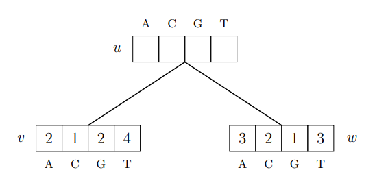

### Assignment 4

WS26/27
Remi Becker, Nina Ropertz

#### 1: Biological Background
- What are the data?
  78 protein-coding plastome genes
- Which plant families and genera do the 17 genomes represent?
  3 families with a total of 8 genera:
    - Nymphaeaceae (5 genera)
    - Cambombaceae (2 genera)
    - Hydatellaceae (1 genus)
- Which of them is the outgroup?
  Hydatellaceae
- What is the main question?
  Evaluating evolutionary relationships within Nymphaeales, especially to re-assess the monophyly of Nymphaeaceae by assessing whether the results of phylogenetic inference performed individual genes are congruent across genes and those performed on the multiple alignment congruent under different data partitioning schemes.
- Why does the genus *Nuphar* matter for it?
  The phylogenetic position of the genus *Nuphar* is so far unresolved and would affect the taxanomic status of Nymphaeaceae as a monophyletic group. Determining this would help in the effort to understand the evolutionary history of early-diverging angiosperms.

#### 2: Multiple sequence alignment
a)

#### 3: visualization of multiple sequence alignments (1 point)

#### 4: Phylogenetic trees (2 points)

#### 5: Consensus tree (1 points)

#### 6: Consensus network (2 point)

#### 7: Sankoff's algorithm by hand (1 points)

Cost matrix M:
$$
\begin{array}{c|cccc}
\text{cost} & A & C & G & T\\ \hline
A & 0 & 2 & 1 & 2\\
C & 2 & 0 & 2 & 1\\
G & 1 & 2 & 0 & 2\\
T & 2 & 1 & 2 & 0\\
\end{array}
$$

  

$$S_\alpha (v) = \min_\beta (S_\beta(u) + m(\alpha, \beta)) + \min_\beta (S_\beta(w) + m(\alpha,\beta))$$

child v, $S(v) = (2,1,2,4)$:
$$
\begin{array}{ccc}
\alpha & \text{calculation } (\beta = (A, C, G, T)) & \text{minimum}\\ \hline
A & (2+0), (1+2), (2+1), (4 +2)  & 2 \\
C & (2+2), (1+0), (2+2), (4+1) & 1 \\
G & (2+1), (1+2), (2+0), (4+2) & 2 \\
T & (2+2), (1+1), (2+2), (4+0) & 2 \\
\end{array}
$$

child w, $S(w) = (3,2,1,3)$:
$$
\begin{array}{ccc}
\alpha & \text{calculation }(\beta = (A,C,G,T)) & \text{minimum}\\ \hline
A & (3+0), (2+2), (1+1), (3+2) & 2 \\
C & (3+2), (2+0), (1+2), (3+1) & 2 \\
G & (3+1), (2+2), (1+0), (3+2) & 1 \\
T & (3+2), (2+1), (1+2), (3+0) & 3 \\
\end{array}
$$
Sum: $S(u) = (2+2) , (1+2), (2+1) , (2+3) = (4,3,3,5)$

$\Rightarrow$ the minimal overall costs are 3, assumed for u = C and u = G

$$
\begin{array}{ccc}
\alpha (\text{state of }u) & \text{child } v \text{ chooses }\beta & \text{child } w \text{ chooses }\beta \\ \hline
A & \text{A } (2+0) & \text{G } (1+1)\\
C & \text{C } ( 1+0) & \text{C }(2+0) \\
G & \text{G } (2+0) & \text{G }(1 + 0) \\
T & \text{C }(1+1) & \text{C, G or T } (3) \\
\end{array}
$$

traceback:
$$
\begin{array}{cccccc}
\text{u} & v\text{ chooses }\beta & \text{costs} & w\text{ chooses }\beta & \text{costs} & \text{sum} \\ \hline
C & C & 1+0 = 1 & C & 2+0 = 2 & 3 \\
G & G & 2+0 = 2 & G & 1+0 = 1 & 3 
\end{array}
$$

This means there are two equally optimal reconstructions (u,v,w) = (C, C, C) and (G, G, G).
There are no mutations on the edges of both, the costs are completely in the leaf vectors S(v) and S(w). 