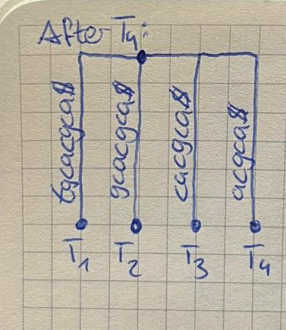
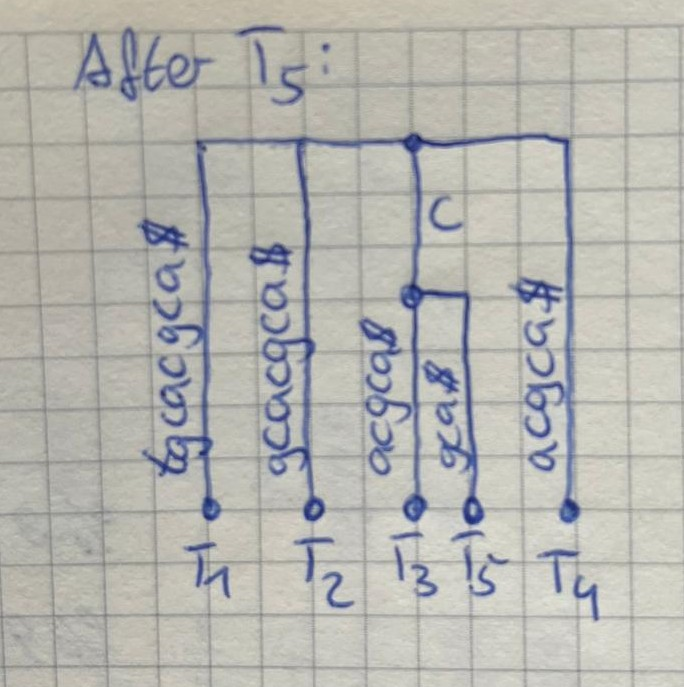
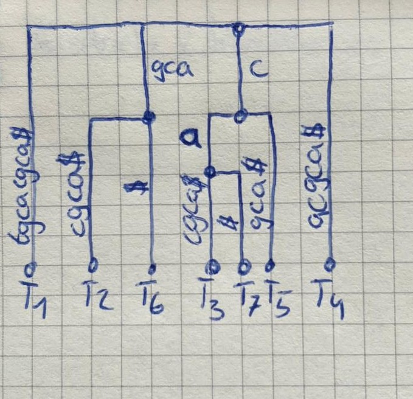
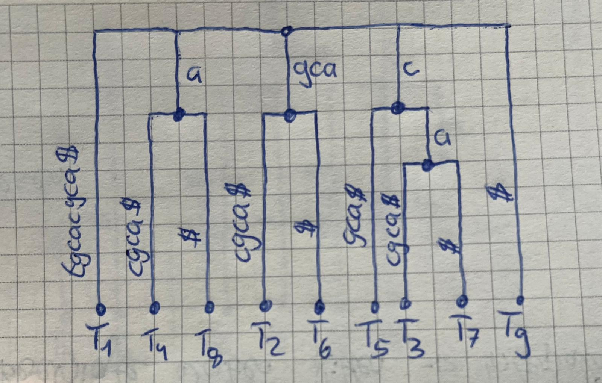

## Assignment05

Remi Becker
Nina Ropertz

#### 1 Setting up the analysis in BEAUti

#### 2 Running BEAST and inspecting the run in Tracer

#### 3 A longer chain

#### 4 Summarizing the sample

### Part B: The suffix tree

#### 5 A suffix tree by hand

Let T = tgcacgca$ with n = 9

a)
$$
\begin{aligned}
&T_1 = tgcacgca$ \\
&T_2 = gcacgca$ \\
&T_3 = cacgca$ \\
&T_4 = acgca$ \\
&T_5 = cgca$ \\
&T_6 = gca$ \\
&T_7 = ca$ \\
&T_8 = a$ \\
&T_9 = $ \\
\end{aligned}
$$
**After $T_4$:** 

no shared prefixes

**After $T_5$:**

shred prefixes:
c in $T_3$ and $T_5$

**After $T_7$:**

shared prefixes:
gca in $T_2$ and $T_6$
c in $T_3$, $T_5$ and $T_7$
ca in $T_3$ and $T_7$

**After $T_9$:**

shared prefixes (= internal nodes besides the root): 4 
gca in T2 and T6
c in T5, T7 and T3
ca in T7 and T3
a in T4 and T8

**Insertions $T_5$ to $T_9$**

- $T_5$ = cgca$ : the walk matches 1 letter, c, and splits the edge cacgca$ . It adds node c and the leaf edge gca$  $\rightarrow$ leaf 5

- $T_6$ = gca$ : the walk matches 3 letters, gca, and splits the edge gcacgca$ . It adds node gca and the leaf edge $ $\rightarrow$ leaf 6

- $T_7$ = ca$ : the walk matches 2 letter, c then a, splits the edge acgca$ below node c. It adds node ca and the leaf edge $ $\rightarrow$ leaf 8

- $T_8$ = a$ : he walk matches 1 letter, a, and splits the edge acgca$. It adds node a and the leaf edge $ $\rightarrow$ leaf 8

- $T_9$ = $ : the walk matches 0 letters and ends at the existing root, with no split. It adds only the leaf edge $ $\rightarrow$ leaf 9

b)

