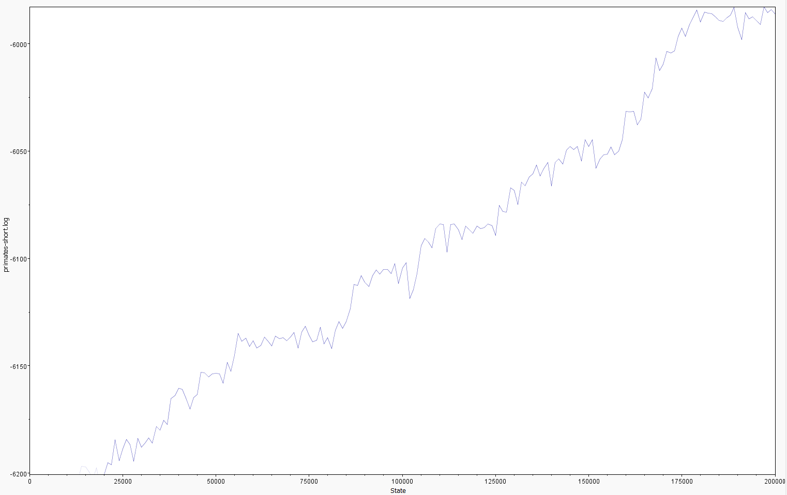
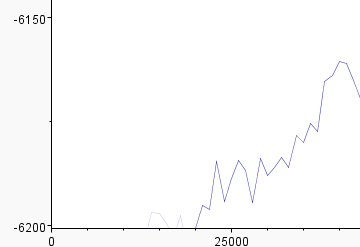
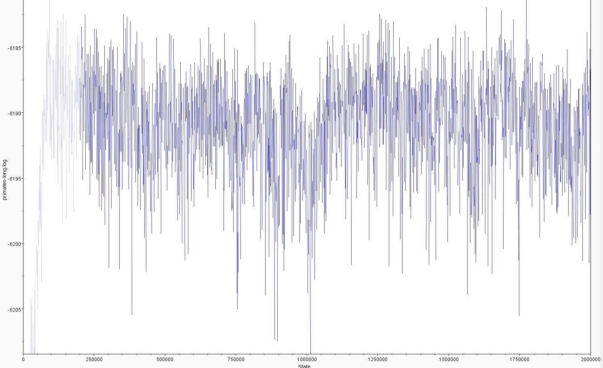
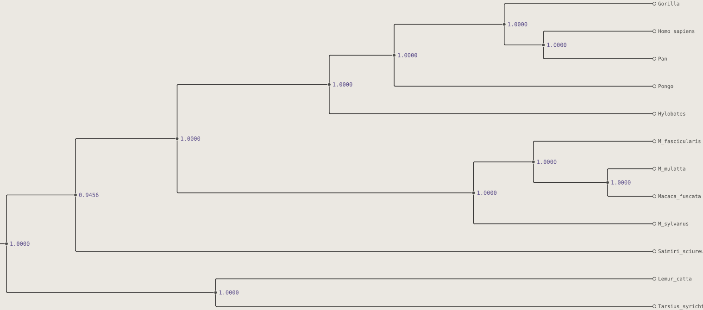
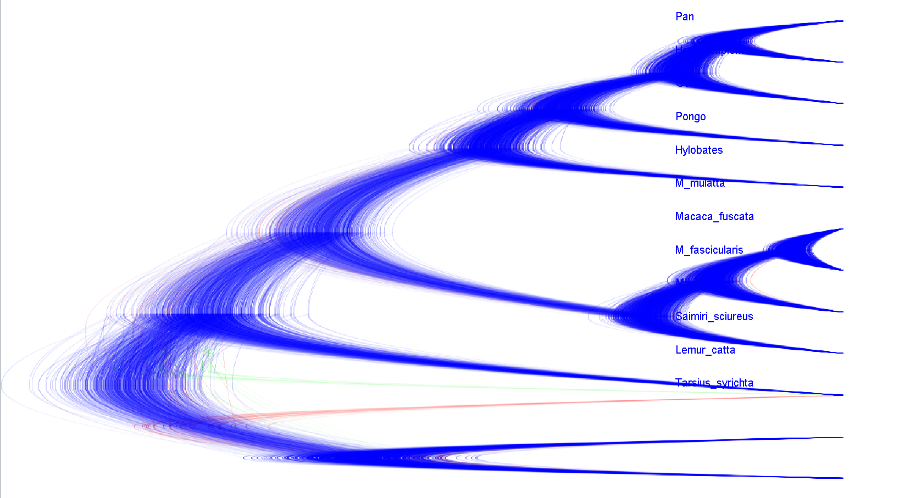

## Assignment05

Remi Becker
Nina Ropertz

#### 1 Setting up the analysis in BEAUti

**a)** P(A|T) is entered by the subset model HKY, because the substitution model defines the probability of the observed sequences along the branches of T with its transition/transversion ratio $\kappa$ and base frequencies.

P(T) is entered by the tree prior of the Yule Model as itself, since it is a probability distribution on tree shapes and branching times.

**b)** The Yule model assumes a pure birth process. Every lineage alive is equally likely to split at a given time, at the same constant rate independently of each other. With a new taxon only attaching to a pendant edge, one leading to a uniformly at random chosen leaf. The attachment restrictions to leaves spreads growth over the tips and produces more balanced trees. While the uniform prior lets the new taxon attach to any edge, including internal ones. This lets the tree keep growing along the same deep edges, which produces unbalanced trees. 

**c)** The chain length is the number of MCMC iterations, meaning how many Metropolis-Hastings propose/accep-or-reject steps the sampler takes. With a chain length of 200 000 and logging every 1000 generations, the tree log gets one tree per 1000 steps. So 200 000 / 1000 = 200 trees. Part of that sample is later discarded as burn-in and the remaining trees approximate the posterior distribution.

#### 2 Running BEAST and inspecting the run in Tracer

Total calculation time: 8.158 seconds
It wrote the files 
Writing file primates-short.log, primates-short-firsthalf.trees and primates-short-secondhalf.trees

**a)** 

| Statistic              | ESS |
| ---------------------- | --- |
| posterior              | 3   |
| likelihood             | 3   |
| prior                  | 6   |
| Tree.firsthalf.height  | 21  |
| Tree.secondhalf.height | 15  |
| kappa.firsthalf        | 3   |
| kappa.secondhalf       | 6   |
All ESS are below 200 and even 100. This means the chain has too few effectively independent samples. The estimates from it can't be trusted.

**b)**

Trace of primate-short.long:

Burn-in

Claude:
The burn-in is tracer's default burn-in and removes only the steepest part of the climb, the first 10 %, 20000 states, shown in grey. The burn-in is discarded because the chain starts from an arbitrary, poor state. Those early samples reflect the starting point, not the posterior distribution, and would bias the estimate of means and HPD intervals.
Tracer shows log values. The likelihood is a product of many probabilities, each between 0 and 1, so it is a tiny number and its log is negative. Summed over all alignment sites this gives a large negative number (around -6000). The log posterior is the log likelihood plus the log prior, and the prior density is also small, so it is negative too. Logs are used to avoid numerical underflow.

**c)** 

Kapas and heights:

| parameter               | mean   | 95 % HPD-intervall | ESS |
| ----------------------- | ------ | ------------------ | --- |
| kappa (firsthalf)       | 3.3745 | [2.0000, 4.5481]   | 2   |
| kappa (secondhalf)      | 4.0672 | [2.0967, 4.9753]   | 6   |
| TreeHeight (firsthalf)  | 0.2376 | [0.2144, 0.2634]   | 21  |
| TreeHeight (secondhalf) | 0.2412 | [0.2108, 0.2695]   | 15  |

HKY:

| parameter                        | base | mean   | 95 % HPD         | ESS |
| -------------------------------- | ---- | ------ | ---------------- | --- |
| freqParameter.1 (first half)  | A    | 0.2520 | [0.2362, 0.2770] | 4.9 |
| freqParameter.2 (first half)  | C    | 0.2591 | [0.2500, 0.2755] | 3.2 |
| freqParameter.3 (first half)  | G    | 0.2291 | [0.1646, 0.2500] | 3.8 |
| freqParameter.4 (first half)  | T    | 0.2598 | [0.2475, 0.2828] | 2.9 |
| freqParameter.1 (second half) | A    | 0.2758 | [0.2473, 0.3412] | 3.2 |
| freqParameter.2 (second half) | C    | 0.2590 | [0.2347, 0.2878] | 4.8 |
| freqParameter.3 (second half) | G    | 0.1957 | [0.1230, 0.2416] | 2.5 |
| freqParameter.4 (second half) | T    | 0.2695 | [0.2488, 0.2976] | 4.5 |
Not trustworthy

All ESS-values are way below 200 (only 181 samples, auto-correlational partly > 70 000). The trace is still rising, the chain is not converged. Mean and HPD-interval are therefore untrustworthy.

#### 3 A longer chain

|                        | short (200000) | long (2000000) |
| ---------------------- | -------------- | -------------- |
| running time           | 8.158 seconds  | 75.055 seconds |
| **Statistic ESS**      |                |                |
| posterior              | 3              | 174            |
| likelihood             | 3              | 158            |
| prior                  | 6              | 951            |
| Tree.firsthalf.height  | 21             | 1133           |
| Tree.secondhalf.height | 15             | 1801           |
| kappa.firsthalf        | 3              | 50 (only one)  |
| kappa.secondhalf       | 6              | -              |

| Estimates              | short | long  |
| ---------------------- | ----- | ----- |
| kappa (first half)     | 3.374 | 4.781 |
| kappa second half      | 4.067 | -     |
| tree.firsthalf.height  | 0.238 | 0.252 |
| tree.secondhalf.height | 0.241 | 0.224 |
Claude:
ESS = N/ACT, where N is the number of samples and ACT is the auto-correlation time. With the same operators, ACT stays roughly constant, so ten times more states gives about ten times the ESS. Our table shows more than that, e.g. for posterior 3 to 174, because the short run was still climbing toward the plateau, which inflated its ACT. The long run is stationary after about 150 000 states.

The estimates move little because the error of a mean is roughly $\frac{sd}{\sqrt(ESS)}$. The short-run means were already close to the posterior, just noisy. Tree heights and kappa shiftes by about one posterior sd or less (e.g. 0.238 -> 0.252, 3.37 -> 4.78). The long-run values are simply more reliable.

For an ESS of > 200 a required chain length = $\frac{200}{ESS \times \text{ current length}}$

From the short run (worst ESS = 2.5 for kappa.firsthalf) about 16 million states
From the long run (kappa.firsthalf ESS = 50 at 2 million): about 8 million states

So 10 to 20 million states need to be run, which would roughly take 6 to 12 minutes so that every ESS value is above 200.

#### 4 Summarizing the sample
**a)**

The topology is the same that NJ and maximum-likelihood found in Figure 4.5. Every clade has posterior probability 1.0 except for the clade joining Saimiri to the Catarrhini, which is 0.9456. This means the placement of Saimiri is the only uncertain point.

Bootstrap values and posterior clade probabilities both measure support for a clade as the fraction of trees containing it. They differ in that bootstrap trees come from resampled alignments. Whereas the posterior is the fraction of MCMC trees and gives the probability of the clade given the data, model and prior. For Homo + Pan the posterior, 1.0, is higher than the bootstrap, 56 % under JC and 93 % under the selected model.

**b)**

Identical to Figure 4.12, the DensiTree plot is tight at the tips and spreads strongly towards the root. The spread mostly shows uncertainty in branch lengths and node heights, especially the age of the deepest divergences. 

Only a few red and green trees place Saimiri or Tarsius differently, which is consistent with the posterior of 0.9456.
### Part B: The suffix tree

#### 5 A suffix tree by hand

Let T = tgcacgca$ with n = 9

a)
$$
\begin{aligned}
&T_1 = tgcacgca$ \\
&T_2 = gcacgca$ \\
&T_3 = cacgca$ \\
&T_4 = acgca$ \\
&T_5 = cgca$ \\
&T_6 = gca$ \\
&T_7 = ca$ \\
&T_8 = a$ \\
&T_9 = $ \\
\end{aligned}
$$
**After $T_4$:** 

no shared prefixes

**After $T_5$:**

shred prefixes:
c in $T_3$ and $T_5$

**After $T_7$:**

shared prefixes:
gca in $T_2$ and $T_6$
c in $T_3$, $T_5$ and $T_7$
ca in $T_3$ and $T_7$

**After $T_9$:**

shared prefixes (= internal nodes besides the root): 4 
gca in T2 and T6
c in T5, T7 and T3
ca in T7 and T3
a in T4 and T8

**Insertions $T_5$ to $T_9$**

- $T_5$ = cgca$ : the walk matches 1 letter, c, and splits the edge cacgca$ . It adds node c and the leaf edge gca$  $\rightarrow$ leaf 5

- $T_6$ = gca$ : the walk matches 3 letters, gca, and splits the edge gcacgca$ . It adds node gca and the leaf edge $ $\rightarrow$ leaf 6

- $T_7$ = ca$ : the walk matches 2 letter, c then a, splits the edge acgca$ below node c. It adds node ca and the leaf edge $ $\rightarrow$ leaf 8

- $T_8$ = a$ : he walk matches 1 letter, a, and splits the edge acgca$. It adds node a and the leaf edge $ $\rightarrow$ leaf 8

- $T_9$ = $ : the walk matches 0 letters and ends at the existing root, with no split. It adds only the leaf edge $ $\rightarrow$ leaf 9

**b)** 
**gca:** The edge gca compares and matches all 3 letters. The query ends at the end of the edge, so the comparison ends at the following internal node. The leafs below are $T_2$ and $T_6$ which leaves the following output {2,6}, with no other edge matching the first letter g.

**cac:** The root edge c leads to an internal node and matches the first letter. The following leaf mismatches the second letter a, against a g. The following edge matches a against a. This edge is then followed by the leaf cgca$ and matches the third letter c at the first position of the leave $T_3$ so three letters are compared, the output is {3}.

**cat:** Below edge c from the root leads to an internal node and matches with the first letter. The following leaf mismatches at the second position a against g and returns $\emptyset$. The following edge matches the second letter a but mismatches the third letter t at the following leafs T3 and T7 with g and $ and returns $\emptyset$. This means there is no occurrences and since letter t only occurs at position 1 there could not be any.

**gcg:** The root edge gca matches the first two letters and mismatches the third, g against a. The algorithm returns $\emptyset$ after comparing three letters.

