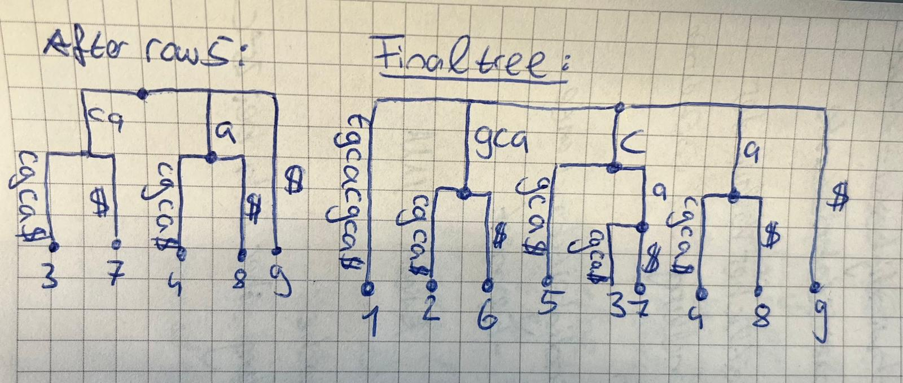

Assignment06 WS 26/27
Remi Becker, Nina Ropertz

# Part A: Suffix tree and maximal unique matches in Java

## 1 The naive suffix tree

Output for: acatgatcatt

T = acatgatcatt$
[12..12] $ (12)
[1..1] a
  [2..12] catgatcatt$ (1)
  [4..4] t
    [8..12] catt$ (6)
    [5..12] gatcatt$ (3)
    [11..12] t$ (9)
[2..4] cat
  [5..12] gatcatt$ (2)
  [11..12] t$ (8)
[5..12] gatcatt$ (5)
[4..4] t
  [12..12] $ (11)
  [8..12] catt$ (7)
  [5..12] gatcatt$ (4)
  [11..12] t$ (10)
internal nodes: 5, leaves: 12, letters matched: 11

Output for: tgcacgca

T = tgcacgca$
[9..9] $ (9)
[4..4] a
  [9..9] $ (8)
  [5..9] cgca$ (4)
[3..3] c
  [4..4] a
    [9..9] $ (7)
    [5..9] cgca$ (3)
  [6..9] gca$ (5)
[2..4] gca
  [9..9] $ (6)
  [5..9] cgca$ (2)
[1..9] tgcacgca$ (1)
internal nodes: 5, leaves: 9, letters matched: 7

## 2 Maximal unique matches

c) letters matched for human genome: 108998

# Part B: The suffix array and the LCP array by hand

## 3 The two arrays, and searching with them

a)
T = tgcacgca$ n = 9 

lexicographic order: $ < # < a < c < g < t

| k   | SA[k] | LCP[k] | suffix $X_{SA[k]}$ | turning node     |
| --- | ----- | ------ | ------------------ | ---------------- |
| 1   | 9     | -      | $                  | no previous leaf |
| 2   | 8     | 0      | a$                 | root             |
| 3   | 4     | 1      | acgca$             | node a           |
| 4   | 7     | 0      | ca$                | root             |
| 5   | 3     | 2      | cacgca$            | node ca          |
| 6   | 5     | 1      | cgca$              | node c           |
| 7   | 6     | 0      | gca$               | root             |
| 8   | 2     | 3      | gcacgca$           | node gca         |
| 9   | 1     | 0      | tgcacgca$          | root             |
b)
$[l,r] = [1,n]$ 
search for left end of the block with $m = \lfloor(l+r)/2\rfloor$ searching for the first row whose suffix is not smaller than the query and continuous with $[m+1,r]$if the suffix in row m is smaller than the query, otherwise $[l,m]$ 

search for right end of the block with $m = \lceil(l+r)/2\rceil$  and continue with $[l, m-1]$ if the suffix in row m is larger than the query and does not begin with it, otherwise $[m,r]$.

gca, 

| queries | left probes | l   | right probes | r   | positions            |
| ------- | ----------- | --- | ------------ | --- | -------------------- |
| gca     | 5, 7, 6     | 7   | 5, 7, 8, 9   | 8   | SA[7] = 6, SA[8] = 2 |
| cac     | 5, 3, 4     | 5   | 5, 7, 6      | 5   | SA[5] = 3            |
| cat     | 5,7, 6      | 6   | 5, 7, 6      | 5   | no                   |
| gcg     | 5,7,8       | 9   | 5, 7, 8, 9   | 8   | no                   |
Letter count for gca:
- left search: probe 5 (cacgca$ vs gca) compares 1 letter, probe 7 (gca$ ) compares 3 and probe 6 (cgca$ ) compares 1. Overall 5 comparisons for left probes.
- right search: probe 5 compares 1, probe 7 compares 3, probe 8 compares 3 and probe 9 compares 1. Overall 8 comparisons for right probes

$\Rightarrow$ 13 letters compared in total

In assignment 5 only 3 letters are compared because the edge gca is directly below the root. The binary search costs more comparisons O(m log n) compared with O(m) for the tree walk. In return, the suffix array needs much less memory, an array of n integers, with no nodes, edges or pointer. It is simpler build and implemented. 

## 4 Kasai's algorithm, and back to the tree

a) 
rank = (9,8,5,3,6,7,4,2,1)

| i   | $T_i$     | row | known | suffix row above | compared        | result |
| --- | --------- | --- | ----- | ---------------- | --------------- | ------ |
| 1   | tgcacgca$ | 9   | 0     | gcacgca$         | t $\neq$ g      | 0      |
| 2   | gcacgca$  | 8   | 0     | gca$             | gca, c $\neq$ $ | 3      |
| 3   | cacgca$   | 5   | 2     | ca$              | c $\neq$ $      | 2      |
| 4   | acgca$    | 3   | 1     | a$               | c $\neq$ $      | 1      |
| 5   | cgca$     | 6   | 0     | cacgca$          | c, g $\neq$ a   | 1      |
| 6   | gca$      | 7   | 0     | cgca$            | g $\neq$ c      | 0      |
| 7   | ca$       | 4   | 0     | acgca$           | c $\neq$ a      | 0      |
| 8   | a$        | 2   | 0     | $                | a $\neq$ $      | 0      |
| 9   | $         | 1   | 0     | -                | none            | 0      |

LCP array = $[-01021030]$
Kasai: 1 + 4 + 1 +1 + 2 + 1 + 1 + 1 + 1 = 13 comparisons including the last unequal pair
Comparisons from the first letter on: 1 + 4 + 3 + 2 + 2 + 1 + 1 + 1 + 1 = 16

 The algorithm skips letters for $T_3$, the first two, and for $T_4$ the first one, because $T_{i-1}$ has LCP value h > 0 with the suffix $T_j$ above it, $T_{j+1}$ and $T_i$ share at least h - 1 letters.

b)

special row at k = 6. The split edge leads to the internal node ca, not to a leaf. In rows 3, 5 and 8 the split edge always ended in a leaf.
The LCP values around it:
LCP$[5]$ = 2 created node at depth 2
LCP$[6]$ = 1 is smaller than 2, so node is popped
LCP$[6]$ = 1 is larger than 0, which is the depth of the root below it. No node of depth 1 exists, so the edge from the root to ca is split at depth 1.

The  suffix tree from assignment5 is identical. It also has the internal nodes a, gca, c and ca and the same leaves.  

## 5 MUMs in the generalized suffix array

S= ggtact T = ctatac X = S#T$
a)

$X = [ggtact\#ctatac\$]$ 

lexicographic order: $ < # < a < c < g < t

| k   | SA[k] | from | LCP[k] | suffix $X_{SA[k]}$ |
| --- | ----- | ---- | ------ | ------------------ |
| 1   | 14    |      | -      | $                  |
| 2   | 7     |      | 0      | $\#ctatac$$        |
| 3   | 12    | T,5  | 0      | ac$                |
| 4   | 4     | S,4  | 2      | act#ctatac$        |
| 5   | 10    | T,3  | 1      | atac$              |
| 6   | 13    | T,6  | 0      | c$                 |
| 7   | 5     | S,5  | 1      | ct#ctatac$         |
| 8   | 8     | T,1  | 2      | ctatac$            |
| 9   | 1     | S,1  | 0      | ggtact#ctatac$     |
| 10  | 2     | S,2  | 1      | gtact#ctatac$      |
| 11  | 6     | S,6  | 0      | t#ctatac$          |
| 12  | 11    | T,4  | 1      | tac$               |
| 13  | 3     | S,3  | 3      | tact#ctatac$       |
| 14  | 9     | T,2  | 2      | tatac$             |

b)

| k   | rows       | prefix, h | (1) S/T?          | (2) h> LCP[k-1], LCP[k+1]?        | letters in front | (3)                                                           |
| --- | ---------- | --------- | ----------------- | --------------------------------- | ---------------- | ------------------------------------------------------------- |
| 4   | T,5 / S,4  | ac, 2     | $\checkmark$      | $\checkmark$ (2 > 0, 2 > 1)       | t / t            | $\unicode{x2717}$ two letters in front identical              |
| 5   | S,4 / T,3  | at, 1     | $\checkmark$      | $\unicode{x2717}$ (1 < 2, 1 > 2)  |                  |                                                               |
| 7   | T,6 / S, 5 | c, 1      | $\checkmark$      | $\unicode{x2717}$ (1 > 0, 1 < 2)  |                  |                                                               |
| 8   | S,5 / T,1  | ct, 2     | $\checkmark$      | $\checkmark$ (2 > 1, 2 > 0)       | a, #             | $\checkmark$ two letters differ, one is start of the sequence |
| 10  | S,1 / S,2  | g, 1      | $\unicode{x2717}$ | $\checkmark$ (1 > 0, 1 > 0)       |                  |                                                               |
| 12  | S,6 / T,4  | t, 1      | $\checkmark$      | $\unicode{x2717}$ ( 1 > 0, 1 < 3) |                  |                                                               |
| 13  | T,4 / S,3  | tac, 3    | $\checkmark$      | $\checkmark$ (3 > 1, 3 > 2)       | t / g            | $\checkmark$ two letters in front differ                      |
| 14  | S,3 / T,4  | ta, 2     | $\checkmark$      | $\unicode{x2717}$ ( 2 < 3)        |                  |                                                               |

maximal unique matches: 
1. ct at position S,5 and T,1
2. tac at position S,3 and T,4

ta is excluded on the premise that it fails condition 2 as show in the table above. Three suffixes start with ta: S,3, T,4 and T,2. This means ta occurs one in S and twice in T, which means it is not unique in T. It is therefore not a unique match even though it occurs in both sequences. This was tested by condition 2.
